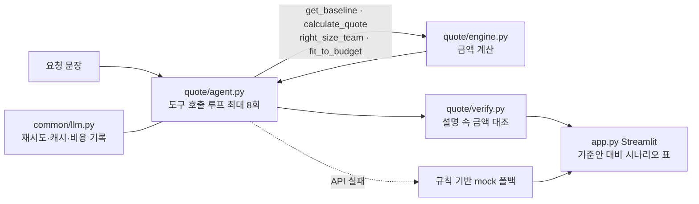

# 견적 에이전트 발표 (초안 — 15:05 작성, 엔진 동결 전)
> 상태 표기: ✅ 실행·열람으로 확인 / ⏳ 엔진·에이전트 동결 후 채움 / ❓ 미확인. 수치의 출처는 `docs/evidence.md`.
> 작성 시점 코드는 다른 세션이 계속 수정 중이다. 동결 후 4·6·9번의 ⏳ 항목만 다시 확인한다.

## 1. 문제
- 컨설팅 회사가 같은 유형의 용역(서울대 연구행정시스템 PI)을 다른 대학에 제안할 때, 기간·인원·범위·조건이 바뀔 때마다 견적을 손으로 다시 만든다.
- 단가·기준안 같은 내부 정보는 공개돼 있지 않다(회사 공개 사이트에는 수주 공지뿐이었음 — `decisions.md`). 그래서 **가정값을 숨기지 않고 화면에 밝히는 구조**가 필요했다.

## 2. 접근·구조도
판단 1: **금액은 LLM이 아니라 파이썬 엔진이 계산**한다(재현·테스트 가능). LLM은 요청 해석, 시나리오 선택, 설명만 맡는다.

내가 내린 판단(이유 한 줄씩)
- **엔진/LLM 분리** — 숫자는 테스트로 재현돼야 하고, 모델이 계산하면 조용히 틀린다.
- **도구 호출 루프 + 강제 `tool_choice` 미사용** — Sonnet 5.5에서 강제 `tool_choice`가 400이라 쓰지 않고, 입력 검증 오류는 모델에 돌려 재시도시킨다.
- **설명 속 금액 대조(`verify.py`)** — 모델이 엔진에 없는 금액을 말하면 "미검증"으로 표시한다(지어낸 숫자 방어).
- **API 실패 시 mock 폴백** — 데모가 죽지 않게. 화면에 mock이라고 표시해 정확도가 낮음을 숨기지 않는다.
- 버린 것: 가격표를 외부에서 긁어와 단가 근거로 쓰기 — 공개 입찰은 추정가격뿐이라 단가의 근거가 못 된다(`docs/reference_bids.md`).

## 3. 데모 시나리오 (1개로 확정 ⏳)
앱 예시 문구 중 하나를 정상 흐름으로 쓴다(입력 문구는 `app.py`의 `EXAMPLES`).
1. "고려대에서 같은 용역을 3개월에 5명으로 요청했어. 견적 보여줘" 입력
2. 시나리오 표에서 기준안(353,560,000원) 대비 차이와 경고 확인
3. 사이드바의 가정값과 "도구 호출 기록" 펼쳐 보여 주기 — 금액이 엔진 출력임을 설명
4. (여유 시) 예산 제시 문구로 `fit_to_budget` 대안 보여 주기 ⏳
- 화면은 탭 7개(요약·견적서·비교·근거·민감도·조건 확인·수정·이력·기록)로 나뉜다. 15:55에 mock 경로로 실행해 탭 라벨 7개와 예외 없음을 직접 확인했다(실제 브라우저·API 경로는 `0-96`이 확인했다고 보고).
- **시연 주의**: 입력창을 폼으로 묶어(`0-96`, 실제 브라우저에서 확인했다고 보고, 제 AppTest에서도 입력만 바꿔서는 결과가 유지됨을 확인) 계산 중 타이핑으로 결과가 사라지는 문제는 해결됐다. 다만 계산 중에 '견적 만들기'를 다시 누르면 이전 계산이 버려지고 새 요청이 시작된다. 취소 버튼은 없다(다음 단계).
- 사이드바의 '시연 저장본 우선 사용'을 켜면 예시 문장은 저장된 결과로 즉시 나온다(저장본 5건, 15:48 생성, 실제 API 결과). 저장본으로 보여 줄 때는 그렇다고 말한다.
- ❓ 실제 API로 이 문구를 돌린 화면은 이 세션에서 저장하지 않았다.

## 4. 결과·한계
확인된 것 ✅
- 기준안 공급가액 321,418,000원 / VAT 32,142,000원 / 합계 353,560,000원 (엔진 출력, `evidence.md` ①).
- pytest 136개 통과(18:57 직접 실행). 엔진 골든셋 18/18(`golden.jsonl`). 골든셋 기대값은 코드 출력이 아니라 도메인 논리로 정했다(같은 인원·기간이면 같은 가격, 할인 상한 15% 등 — `golden.jsonl` 머리말).
- 에이전트 골든셋(`answers.jsonl`, 실제 API) 18/18 — 최종 프롬프트로 `0-96`이 재실행한 결과(`logs/answers_run3.txt`의 PASS는 이 세션이 열람)이며 이 세션에서는 재실행하지 않았다. **단 같은 세트가 직전엔 17/18**(a08b: 모델이 초과액 47,196,000원을 '46,000,000원 가까이'로 반올림해 금액 검증기가 미검증으로 잡음). 4회 중 1회 재현, 프롬프트에서 반올림을 금지한 뒤 18/18. → 통과율은 실행마다 달라질 수 있어 "항상 18/18"이라 말하지 않는다.
- 공개 입찰 3건(40,000,000 / 272,727,273 / 312,727,273원)과 자릿수만 대조 — 기준안이 규모상 비슷한 자릿수라는 확인일 뿐 단가 근거는 아니다.
- 실제 API 비용(앱 런타임, `cost_report.py` 18:57 직접 실행): 호출 307회, 입력 296,916 / 출력 109,456 토큰, 합계 $2.1529, 호출당 평균 $0.0070. 평가 실행(에이전트 골든셋 반복)이 대부분을 차지한다. **개발에 쓴 AI 사용량은 포함되지 않는다.** 단가표 기준일 2026-10-06(발표 전 재확인). ⏳ 동결 후 재실행

한계 (정직하게)
- **단가·가산율·대학 규모 계수·모듈 비중은 모두 가정값**이다. 금액의 절대 수준은 근거가 없고, 구조(무엇이 바뀌면 얼마가 바뀌는가)만 검증 대상이다.
- mock 폴백은 규칙 기반이라 정확도가 낮다(범위·산출물·예산 해석 안 함).
- **외부 전송**: 요청 문장과 엔진 결과가 Anthropic API로 나간다(프롬프트 원문은 `usage.jsonl`에 저장하지 않음). 실제 고객사 이름이나 실제 단가를 쓰려면 보안·계약 검토가 먼저다.
- **효력**: 출력은 가정값 기반 초안이다. 확정 견적이나 계약 근거로 쓰지 않는다(화면 상단에 고지 문구가 반영됨, `0-96`이 실제 브라우저로 확인했다고 보고).
- **장기 실행 서버**: 코드 변경 뒤 오래 떠 있던 서버는 깨질 수 있어 시연 전 재시작이 필요하다.
- **로컬 시연 전용**: 공개 배포 전에는 접근 제어와 호출 횟수 제한이 필요하다(지금은 코드에서 찾지 못함). 입력 길이는 mock 경로에서만 2000자 초과를 거부한다(`0-96` 보고, API 경로는 확인 못 함). 반복 8회 한도는 요청 한 건의 비용 상한일 뿐 요청 건수의 상한은 아니다. 동시 접속 시 가정값 전역 상태가 섞일 수 있다(검토 안 함).
- **표 반올림**: 항목별 천 원 단위 반올림 차이는 마지막 칸에 잔차를 붙여 해결했다(15:29 세 경우 합계 일치를 직접 확인).
- `golden.jsonl`은 엔진 로직용이고, 에이전트 해석 골든셋(`answers.jsonl`)의 18/18은 위의 보고값(재실행 안 함)이다. 학습·평가 세트가 같다: a08b는 실패를 본 뒤 프롬프트를 고쳐 통과시켰으므로 일반화 정확도가 아니라 **회귀 방어선**이다.
- 신규 항목(`extra_items`)의 공수 %는 LLM 추정이라 근거가 약하다. 화면·답변에 "추정"이라고 밝히도록 프롬프트에 규칙을 뒀지만 실제 준수율은 ❓.

## 5. 다음 단계
- 실제 과거 견적서가 있다면 단가·규모 계수를 그 데이터로 보정(지금은 가정값).
- 에이전트 해석 정확도용 골든셋(문장 → 기대 파라미터) 추가.
- 신규 항목 공수 추정에 유사 과거 사례 검색(RAG) 연결.
- 견적서 양식 맞춤 출력: 엑셀 내려받기(초안)는 이미 있다(`quote/export.py`). 실제 발주처 양식에 매핑하는 일이 남았다.

## 6. AI 활용·검증
프롬프트·설계 전략
- 시스템 프롬프트에 규칙을 명시: 금액은 도구 결과만 인용, 안 준 값은 기준안 유지 후 가정 명시, 도구로 반영 못 한 요구는 "반영하지 못한 요구"로 적기, 6문장 이내.
- 금액은 '317,690,000원'처럼 원 단위 전체로 쓰게 해 검증기(`verify.py`)가 대조할 수 있게 했다.

AI 결과를 확인한 방법
- 엔진은 테스트로 고정: 기대값은 구조에서 도출(예: 산출물 하나를 빼면 `capacity = 1/0.6`).
- 설명 속 금액은 `verify.py`가 엔진 결과·차이·사용자 예산과 대조.
- 공개 입찰 자료는 원문 페이지를 직접 열어 확인한 것만 기록.

AI가 틀렸던 사례와 대응 (기록에 있는 것만)
1. **mock 폴백 팀 인원 오류** — 요청 인원(N명)과 mock이 만든 팀 합계가 달랐다. 커밋 86a942d에서 수정하고 `test_mock_team_size_matches_request`(1·2·5·9·20명)를 회귀 테스트로 추가.
2. **검색 요약의 수치 오류** — 검색 요약에 있던 "우정사업본부 낙찰율 96.8%"와 "교육정보 재해복구 ISP 약 4.45억 원"은 원문에서 확인되지 않아 폐기하고 `reference_bids.md`의 정정 기록에 남겼다.
3. **강제 `tool_choice` 400** — Sonnet 5.5 제약. 강제 호출 대신 도구 루프 + 검증 오류 재시도로 설계(`decisions.md`).
4. **모델의 금액 반올림** — 에이전트 골든셋 a08b에서 모델이 초과액 47,196,000원을 '46,000,000원 가까이'로 말했고 `verify.py`가 미검증 금액으로 잡았다(4회 중 1회). 시스템 프롬프트에 반올림 금지를 추가해 18/18로 복구. 검증기가 실제로 지어낸/바뀐 숫자를 잡은 사례다(출처: `0-96`의 실행 보고, 이 세션에서 재현 안 함).
5. **mock의 부정어 오해석** — '상주 없음'을 상주로 해석. interviewer 검토 중 이 세션이 실행으로 재현, 부정어 처리와 회귀 테스트로 수정(Q5).
6. **독립 검증(verifier) FAIL** — mock이 카이스트·역할별 인원·음수·0·초과값을 조용히 잘못 읽거나 죽던 것, 같은 이름의 신규 항목 중복, 검증기가 '4억'·'3억 9천만원'을 통과시키던 것. `0-96`이 재현해 테스트부터 붙여 고쳤다(pytest 56, `check.py` 5 PASS·1 WARN·0 FAIL은 `0-96` 보고값).
7. **엑셀 수식 주입** — 시나리오 라벨이나 신규 항목 이름이 `=`로 시작하면 내려받은 엑셀에서 수식이 된다. 이 세션이 15:32에 실제로 재현(수식 셀 2개)했고 `0-96`이 모든 문자열 셀을 텍스트로 고정, 15:34 재실행에서 수식 셀 0개를 확인했다.
- 독립 검증(verifier)은 3회 돌려 매번 새 결함이 나왔고 모두 고쳤다. 3차 수정은 단위 테스트로만 확인했고 재검증은 돌리지 않았다(`0-96` 보고).
- 그 외 사례는 기록 없음(지어내지 않는다).

## 7. 예상 Q&A (`interviewer` 에이전트 결과 + 이 세션의 직접 실행 검증)
표시: ✔ 실행으로 확인 / 🔍 코드 열람 / ⚠ 약점(질문 받으면 인정하고 답)

**Q1. 에이전트 골든셋 18/18이 일반화 정확도인가?**
- 아니다. 회귀 방어선이다. a08b는 실패를 본 뒤 프롬프트 규칙을 추가해 고친 케이스라 학습·평가 데이터가 같고, 문장당 API 1회(`lru_cache`), 4회 중 1회 실패가 유일한 분산 정보다.
- ⚠ a06·a07·a11은 키워드 정규식이라 느슨하다. a08의 `cheapest_total`은 전체 시나리오 최솟값이라 초과 안이 섞여도 통과할 수 있다. 18/18은 재실행하지 않은 보고값이다.

**Q2. 범위를 줄이거나 작은 대학이면 가격이 왜 안 내려가나?** ← 가장 방어하기 어려움
- 가격은 `팀 × 기간 × 가산율`로만 정해지고 대학 규모·단계·산출물은 **필요 공수(경고)**에만 들어간다. 골든 e04가 의도로 고정했다. 보완책이 `right_size_team`이다.
- ✔ 단계 하나를 뺀 요청은 인원 그대로면 총액이 기준안과 같고(true) "공수 154% 과다" 경고가 뜬다. `right_size_team`을 적용하면 220,333,000원(공수 1.026)으로 내려간다.
- ⚠ 팀 재설계 호출은 코드가 아니라 LLM이 프롬프트를 따르는지에 달려 있고 준수율은 미측정이다. 같은 범위에서도 재설계 팀(PM1·수석1·컨설턴트1·분석가3)은 총액이 -20,497,000원이라 "범위 효과"와 "팀 구성 효과"가 섞인다.
- 시연 팁: "범위를 줄여서 얼마나 내릴 수 있나"를 물으면 경고 → 팀 재설계 순서로 보여 주고, 가격 변화의 원인이 인원 조정임을 말한다.

**Q3. 할인 15%를 허용하면 손실 견적 아닌가?**
- ✔ 15% 할인의 이윤율은 -6.5%이고 "원가보다 6.5% 낮습니다. 손실 견적입니다" 경고가 뜬다. 손실을 막지 않고 드러내는 설계다. 상한은 `assumptions.json`의 `max_discount_pct`로 조정한다.
- ⚠ 상한 15%가 손실선(약 4.5% 초과)과 연동되지 않는 이유는 기록에 없다(답변 곤란 가능). "정책값이라 경고로 알린다"로 답한다.

**Q4. `verify.py`가 못 잡는 지어낸 금액은?**
- 100만 원 이상 원 단위 수치는 정확 일치, 억·만 축약은 표기 자릿수 안에서 인정(`_abbr_value`). 실제로 모델의 반올림을 잡았다(a08b).
- ✔ 독립 검증(verifier)이 "4억", "3억 9천만원"을 통과시키는 허점을 지적했고 `0-96`이 고쳤다. 15:29에 "약 4억입니다", "3억 9천만원"을 넣으면 둘 다 미검증으로 잡히는 것을 직접 확인했다.
- ⚠ 금액이 어떤 항목의 값인지 맥락은 여전히 보지 않는다(안 A 총액을 "기준안 총액"이라 써도 통과). 100만 원 미만 숫자는 검사하지 않는다.

**Q5. mock이 틀리는 입력은?**
- 정확도가 낮다고 화면에 표시하고, 팀 인원 합계는 회귀 테스트가 있다.
- ✔ 발견·수정: "고려대, 4개월, 6명, **상주 없음**"을 mock이 `onsite=True`로 해석하던 버그를 이 세션이 실행으로 찾아 `0-96`이 부정어 처리(상주 없음·비상주·영문 불필요)와 회귀 테스트로 고쳤다(15:17 재확인: '상주 없음'→False, '상주'→True). 이것이 AI 오류 사례 5번이다.
- LLM이 `label`을 생략해 라벨이 겹치는 문제는 '견적 (2)'처럼 번호를 붙이도록 고쳤다(`0-96` 보고, 이 세션에서 미실행).

**Q6. 가정값을 JSON으로 빼서 파일만 바꾸면 되나?**
- 단가·임계값은 `assumptions.json`에서 읽고, pytest는 `conftest.py`가 기본값으로 고정해 파일이 바뀌어도 깨지지 않는다. 파일이 없거나 잘못되면 기본값으로 폴백하고 사유를 기록한다.
- ⚠ 엔진 골든셋(`scripts/eval.py`)은 conftest 밖이라 운영 JSON을 읽고 e18은 353,560,000±5,000으로 박혀 있어 JSON을 바꾸면 깨진다. 시스템 프롬프트·도구 스키마는 import 시점에 한 번 만들어진다. 사이드바 문구는 `0-96`이 설정에서 생성하도록 고쳤다(보고, 미실행 확인). `Quote.assumptions_version`은 기록되지만 화면에 표시되는지 확인하지 못했고, 과거 견적을 저장하는 곳이 없어 "과거 견적 재현"이라고는 말하지 않는다.

**Q7. 2시간 타임라인과 AI 활용을 어떻게 증명하나?**
- 결정 로그에 AI가 틀린 사례 4건과 대응(테스트·원문 열람)이 있다(6절). 시각은 결정 시각이 아니라 파일·커밋 시각이다.
- ⚠ START 14:32, 엔진·에이전트·앱·테스트가 들어간 첫 커밋 14:34(ded4e64)의 경위는 기록에 없다. `decisions.md`에 15:13~15:14처럼 범위로 적힌 시각이 있다. "추측하지 않고 확인 가능한 시각만 적었다"로 설명한다.

**Q8. 실제 견적서 양식이 우리가 만든 것과 다르면?**
- 항목 이름과 구성(기본 인건비·간접경비·기업이윤·가산)은 공개 정보가 없어 우리가 정한 형식이다. 실제 양식(예: 직접인건비·제경비·기술료처럼 다른 명칭과 비율, 등급별 노임단가표)과 다를 수 있다. 이 회사의 실제 양식은 확인하지 못했다.
- 바뀌지 않는 부분: 공수(인원 × 기간)로 필요량을 계산하고 경고를 내는 모델, 엔진/LLM 분리, 금액 대조 검증, 가정값 파일. 바뀌는 부분: 항목 이름과 계산 순서(`calculate`의 line 구성)와 단가표 구조. 단가·비율은 파일로 바꾸면 되지만 항목 구성은 코드 수정이다(소규모, 테스트가 방어선).
- 답변: "양식 샘플을 주시면 항목을 맞추는 건 작은 작업이고, 핵심은 계산 구조와 검증입니다." 엑셀 내려받기(초안, `quote/export.py`)는 있지만 항목 구성은 우리 형식이다. 실제 양식에 맞추는 일은 다음 단계다.

**Q9. 예산 안의 대안 금액이 왜 모두 같나요?**
- 의도된 결과다(`0-96` 확인). 가격은 팀·기간으로만 정해지고 범위(어떤 단계를 뺐는지)는 필요 공수에만 영향을 주기 때문에, 같은 팀·기간이면 범위가 달라도 금액이 같다. 대안마다 달라지는 것은 포기한 범위와 "필요 대비 투입" 경고다. (Q2와 같은 구조에서 나오는 질문이라 같이 답한다.)
- 저장본의 예산 250,000,000원 예시 quotes가 [353,560,000, 220,333,000, 220,333,000, 220,333,000]인 것을 15:49에 직접 확인했다.

**Q10. 실제 서비스로 쓰기에 불편한 점은?**
- 한계는 인정하고 개선 방향을 말한다: 계산 중 입력하면 결과가 사라지고, 응답이 5~13초 걸리는데 진행 표시가 단순하며, 새로고침하면 결과가 사라지고, 탭이 많고, 대학명 표기가 정확해야 규모 계수가 적용된다.
- 동결 후 개선: 입력 폼화(계산 중 타이핑으로 결과 소실 해결)와 대학명 별칭(고대·연대·카이스트·서울대)은 고쳤고 제 실행으로 확인했다. 요약 탭은 숫자(한글 읽기 포함) → 경고 → AI 설명 순으로 바꿨다. 진행 단계 표시, 자동 저장, 재시도 축소, 실행 중 잠금·취소 버튼은 하지 않았다(Streamlit이 블로킹 호출을 끊지 못해 진짜 취소가 어렵고, 단계 표시는 실제 진행과 어긋나면 거짓 안내가 됨). 실제 발주처 양식 대응도 다음 단계다.
- 확인 수준: 위 불편 요소 중 결과 소실, 5~13초 지연, API 연결 불가 시 약 10초 대기는 직접 확인했고, 나머지는 코드를 읽은 추정이다.

**Q11. 대학 규모 계수는 어떻게 정했나요? 처음 가는 곳은요?**
- 근거 없는 가정값이다(서울대 1.0, 고려대 0.8, 연세대 0.85, KAIST 0.6). 코드와 결정 로그에 가정이라고 적혀 있고, `data/assumptions.json`에서 바꾼다. 가격에는 영향이 없고 "필요 공수 대비 투입" 경고 계산에만 쓰인다(서울대와 같은 팀·기간이면 금액이 같음, 골든 e04·e17).
- 처음 가는 곳은 정확히 알 수 없다. 표에 없으면 1.0으로 가정하고 경고를 낸다. 규모 지표(연구과제 수, 사용자 수 등)를 서울대와 비교해 추정하고 범위(0.6~1.0)로 본다.
- 솔직한 약점: 사람이 계수를 입력하는 방식은 임시방편이다. 맞는 방향은 해야 할 일을 항목으로 나누고 항목별 공수를 더해 필요한 인력을 구하는 것이고, 이것을 다음 단계의 가장 중요한 개선으로 말한다. 지금 서비스는 단계·산출물 비중과 추가 항목도 서울대 대비 상대 비교라 같은 한계가 있다.
- 자동으로 구해지지 않는다: 계산(필요 공수, 85% 같은 비율, 경고)은 자동이지만 계수 값 자체는 파일에 넣은 숫자다. 이력 탭에 쌓이는 수주 결과로 계수를 고치는 기능은 아직 없다.

**가장 방어하기 어려운 질문: Q2.** 설계 의도(e04)라서 "우연"이라 답할 수 없고, 보완책의 호출이 LLM 준수에 달려 있다. 즉석 시연 요청이 오면 경고 → 팀 재설계 순서로 보여 주고 원인을 인원 조정으로 말한다.

## 7-2. 발표 전 확인할 것 (질문받기 쉬운 곳)
- "웹서비스"가 아니라 "로컬에서 돌리는 웹 앱"이라고 말한다(배포 안 함).
- 결정 로그에 "(14:3x)"처럼 추정 표기가 남아 있으면 실제 시각으로 고치거나 "파일·커밋 시각 기준"이라고 말한다(`0-96` 소유 파일). 첫 커밋(14:34)이 START(14:32) 2분 뒤인 이유를 설명할 수 있어야 한다.
- 두 세션이 나눠 작업한 사실은 물으면 그대로 말한다(분담: 엔진·테스트·커밋 / 발표 자료·점검).
- `reference_bids.md`의 입찰 URL은 발표에 쓰기 전에 직접 다시 열어 본다(이 세션은 재열람하지 않았다).
- 데모 포트는 `demo_start.ps1` 기본 8501, `0-96`이 띄운 앱은 8599다. 어느 쪽으로 보여 줄지 정해 둔다.

## 8. 데모 실패 대비
- 키 없음/API 실패: 앱이 자동으로 mock 폴백 → 노란 경고문 "API를 쓸 수 없어 규칙 기반 mock으로 동작했습니다"와 함께 총액·기준안 대비 차이·경고 표시. 이 상태를 발표에서 "의도된 안전장치"로 설명한다.
- 미리 저장할 것 ⏳: 정상 흐름 캡처 1장 + 같은 입력의 `logs/` 출력(또는 Streamlit 화면 PNG). 오프라인 대체로 `python -c`가 아니라 `python scripts/eval.py eval/golden.jsonl --target quote/evaltarget.py:engine_case` 결과를 보여 준다.
- 오래 떠 있던 서버는 코드가 바뀐 뒤 모듈 캐시 때문에 깨질 수 있다(8599 서버가 민감도 추가 전 프로세스라 ImportError로 깨져 있던 것을 `0-96`이 실제 브라우저 확인 중 발견해 재시작). **시연 직전에는 서버를 새로 띄운다**(`scripts\demo_start.ps1 -Stop` 후 다시 실행).
- API 연결이 안 될 때 mock으로 넘어가는 시간(15:34 직접 측정): 서버에 연결이 안 되면 약 9.6초(재시도 3회와 대기), 잘못된 키는 약 0.4초. 연결 문제는 스피너가 10초 가까이 돌 수 있으니 말로 채울 거리를 준비한다.
- 최후 수단: 사이드바 가정값 + 기준안 표만으로 구조 설명(엔진은 API와 무관).

## 9. 3분 대본 (슬라이드 9장 기준, 수치는 15:55 동결 시점 값, 발표 직전 한 번 더 확인)
말하듯 읽는다. 슬라이드 순서(사용자가 데모 슬라이드를 맨 뒤로 옮김): 1 표지, 2 문제, 3 만든 방식, 4 제가 정한 것, 5 확인한 결과, 6 한계, 7 AI가 틀린 것, 8 마무리("이제 직접 돌려 보겠습니다"), 9 데모. 라이브 시연은 9장 데모 슬라이드를 띄운 뒤 앱으로 넘어간다. 새로 만든 기능(산식 설명, 이력, 시연 저장본, 가정값 편집)은 화면에서 확인한 뒤에만 대본에 넣는다.

**1. 표지 (0:00)**
견적 에이전트입니다. 같은 용역을 대학마다 다시 계산하던 일을 줄여 보려고 2시간 안에 만들어 봤습니다.

**2. 문제 (0:10)**
서울대에 낸 견적이 있어도, 고려대나 연세대에는 기간이나 인원, 범위가 조금씩 달라서 처음부터 다시 계산하게 됩니다. 조건을 바꾸면 총액이 얼마나 달라지는지가 바로 안 보이는 게 불편했습니다.

**3. 만든 방식 (0:30)**
요청 문장이 들어오면 에이전트가 읽고, 계산 엔진이 금액을 계산하고, 금액 검증을 거쳐서 화면에 나옵니다. 한 줄로 말하면 계산은 코드가 하고, 설명은 AI가 합니다.

**4. 제가 정한 것 (0:55)**
가장 크게 정한 건 금액을 AI에게 맡기지 않은 겁니다. 같은 입력이면 같은 금액이 나와야 하고, 틀리면 테스트로 잡을 수 있어야 해서요. AI가 설명에 쓴 금액이 엔진 값과 다르면 한 번 더 걸러서 표시하고, API가 안 될 때는 규칙 기반 대체 동작으로 넘어갑니다. 공개 입찰 공고로 단가를 맞추는 건 버렸습니다. 공고에는 추정가격만 있어서 단가의 근거가 되지 못했습니다.

**5. 확인한 결과 (1:20)**
테스트는 136개가 통과했습니다. 에이전트 평가는 18건짜리인데, 오늘 다섯 번 돌려서 세 번은 18건을 모두 통과했고 두 번은 17건이었습니다. 실패는 매번 이유가 달라서 하나씩 조사해 고쳤습니다. 표본이 적어서 비율로 말하지는 않겠습니다. API 비용은 평가까지 합쳐 지금까지 2달러쯤입니다.

**6. 한계 (1:45)**
단가와 대학별 규모 계수는 공개된 정보가 없어서 전부 가정한 값입니다. 화면에도 그렇게 적어 뒀고, 설정 파일로 빼서 실제 단가표로 바꿀 수 있게 했습니다. 그래서 금액 자체보다 조건이 바뀔 때의 차이와 경고가 이 도구가 주는 것입니다. 지금은 제 PC에서만 돌아가고, 요청은 외부 API로 나가는 초안 단계입니다.

**7. AI가 틀린 것 (2:10)**
AI가 틀린 것도 있었습니다. 대체 동작이 요청한 인원과 다른 팀을 만들었고, 모델이 금액을 반올림해서 말했고, '상주 없음'을 상주로 읽었고, 엑셀로 내려받을 때 수식이 실행될 수 있는 구멍이 있었습니다. 검증용 에이전트를 세 번 돌렸는데 매번 새 결함이 나왔고, 전부 테스트부터 붙여서 고쳤습니다.

**8. 마무리 (2:30)**
다음에 가장 먼저 바꾸고 싶은 건 공수 산정 방식입니다. 지금은 서울대를 기준으로 상대 비교를 해서 처음 가는 곳에는 약합니다. 해야 할 일을 항목으로 나누고 항목별 공수를 더하는 방식으로 바꾸고 싶습니다. 그다음이 과거 견적으로 단가를 보정하는 것과, 발주처 양식에 맞춘 출력입니다. 이제 직접 돌려 보겠습니다.

**9. 데모 슬라이드 → 브라우저 (2:40)**
이게 방금 말씀드린 요청입니다. 고려대, 3개월, 5명이고, 기준안 353,560,000원과 비교한 결과가 나옵니다. 지금부터 직접 입력해 보겠습니다. (이 슬라이드를 띄운 채 브라우저 탭으로 전환)

## 9-2. 시연 멘트 (슬라이드 9장 이후, 약 2분)
기준: 실제 API 응답은 5~13초 걸린다(15:5x 에이전트 골든셋 로그, 평균 약 8초, 직접 측정이 아니라 `logs/eval_last.json`의 케이스별 시간). 이 시간 동안 화면에는 "에이전트가 견적을 계산하는 중..."이 돈다. 저장본(사이드바 '시연 저장본 우선 사용')을 켜면 즉시 나오지만 그때는 "미리 저장해 둔 결과"라고 밝힌다. 아래 `[ ]`는 동작, 따옴표는 말.

**0:00 입력 [앱 화면으로 전환, 입력창에 요청 입력, '견적 만들기' 클릭]**
"아까 말씀드린 요청 그대로 넣겠습니다. 고려대에서 같은 용역을 3개월, 5명으로 달라고 했습니다."

**0:05 기다리는 8초 [스피너가 돈다]**
"지금 에이전트가 요청을 읽고 계산 엔진을 호출하는 중입니다. 평균 8초쯤 걸립니다. 금액은 AI가 아니라 엔진이 계산하니까, 이 시간은 AI가 요청을 해석하고 설명을 쓰는 시간입니다."
(10초가 넘으면) "API 응답이 조금 느리네요. 잠시만 기다리겠습니다."

**0:15 결과 [요약 탭]**
"맨 위에 금액이 나옵니다. 공급가액, 부가세, 합계가 있고 숫자 옆에 한글로도 읽어 줍니다. 3개월은 13주로 환산됐고, 기준안 353,560,000원과의 차이가 같이 보입니다. 그 아래 경고는 필요한 인력에 비해 투입이 모자라거나 많을 때 뜹니다. AI의 설명 문장은 가장 아래에 있습니다."

**0:35 근거 확인 [근거·민감도 탭 또는 기록 탭]**
"이 숫자가 어디서 나왔는지 보겠습니다. 도구 호출 기록을 열면 금액이 엔진 결과라는 걸 볼 수 있고, 설명에 쓴 금액 중 엔진에 없는 값이 있으면 여기서 미검증으로 걸립니다."

**0:55 비교와 민감도 [비교 탭 → 민감도]**
"기준안과 이번 요청을 항목별로 비교한 표입니다. 그리고 인원을 한 명 더하거나 빼면, 기간을 2주 늘리거나 줄이면 총액이 얼마나 달라지는지도 바로 보입니다. 협상할 때 쓸 수 있는 숫자입니다."

**1:20 조건 확인과 수정 [조건 확인·수정 탭]**
"AI가 요청을 어떻게 이해했는지 이 탭에서 확인하고, 틀렸으면 직접 고쳐서 다시 계산할 수 있습니다."

**1:40 마무리 [견적서 탭 또는 엑셀 내려받기]**
"화면에서 견적서 형태로도 볼 수 있고, 엑셀 초안으로 내려받을 수도 있습니다. 다만 단가는 가정값이라 초안이라는 표시가 붙어 있습니다. 감사합니다."

**막혔을 때**
- 결과 위쪽에 mock 경고가 뜨면: "API에 연결이 안 돼서 규칙 기반으로 넘어갔습니다. 정확도는 낮지만 데모가 멈추지 않도록 만든 안전장치입니다." (저장본이 있는 예시 문장이면 저장본으로 대체될 수 있으니 화면 표시를 보고 말한다.)
- 15초 넘게 응답이 없으면: 사이드바에서 '시연 저장본 우선 사용'을 켜고 예시 문장을 다시 실행, "미리 저장해 둔 결과로 보여 드리겠습니다."
- 계산 중에 '견적 만들기'를 다시 누르면 이전 계산이 버려지고 새 요청이 시작된다. 결과가 뜰 때까지 기다린다(타이핑은 괜찮다).

(시연하며 말로 덧붙일 것) 화면에 실제로 보이는 것만 말한다. 결과 화면의 탭(요약·견적서·비교·근거·민감도·조건 확인·수정·이력·기록) 중 보여 주는 것만 짚고, 금액 옆의 한글 읽기와 화면에서 보는 견적서는 `0-96`이 만든 기능이므로 발표 전에 한 번 열어 확인한 뒤 말한다. 예시를 저장본으로 보여 줄 때는 "미리 저장해 둔 결과"라고 밝힌다. 결과가 뜰 때까지 '견적 만들기'를 다시 누르지 않는다.

(발표 전 확인) ① 136개·2달러·18건/5회 수치는 발표 직전 한 번 더 확인 ② 서버를 새로 띄워 두기 ③ 5장 캡처 넣기 ④ 시간: 천천히 읽어 약 3분이 되는지 한 번 소리 내어 재기
