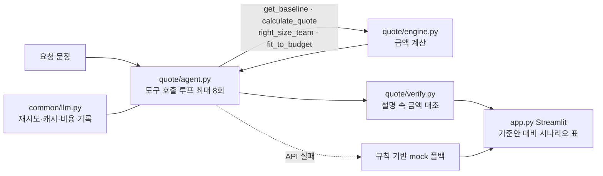

# 견적 에이전트 발표 (초안 — 15:05 작성, 엔진 동결 전)
> 상태 표기: ✅ 실행·열람으로 확인 / ⏳ 엔진·에이전트 동결 후 채움 / ❓ 미확인. 수치의 출처는 `docs/evidence.md`.
> 작성 시점 코드는 다른 세션이 계속 수정 중이다. 동결 후 4·6·9번의 ⏳ 항목만 다시 확인한다.

## 1. 문제
- 컨설팅 회사가 같은 유형의 용역(서울대 연구행정시스템 PI)을 다른 대학에 제안할 때, 기간·인원·범위·조건이 바뀔 때마다 견적을 손으로 다시 만든다.
- 단가·기준안 같은 내부 정보는 공개돼 있지 않다(회사 공개 사이트에는 수주 공지뿐이었음 — `decisions.md`). 그래서 **가정값을 숨기지 않고 화면에 밝히는 구조**가 필요했다.

## 2. 접근·구조도
판단 1: **금액은 LLM이 아니라 파이썬 엔진이 계산**한다(재현·테스트 가능). LLM은 요청 해석, 시나리오 선택, 설명만 맡는다.

내가 내린 판단(이유 한 줄씩)
- **엔진/LLM 분리** — 숫자는 테스트로 재현돼야 하고, 모델이 계산하면 조용히 틀린다.
- **도구 호출 루프 + 강제 `tool_choice` 미사용** — Sonnet 5.5에서 강제 `tool_choice`가 400이라 쓰지 않고, 입력 검증 오류는 모델에 돌려 재시도시킨다.
- **설명 속 금액 대조(`verify.py`)** — 모델이 엔진에 없는 금액을 말하면 "미검증"으로 표시한다(지어낸 숫자 방어).
- **API 실패 시 mock 폴백** — 데모가 죽지 않게. 화면에 mock이라고 표시해 정확도가 낮음을 숨기지 않는다.
- 버린 것: 가격표를 외부에서 긁어와 단가 근거로 쓰기 — 공개 입찰은 추정가격뿐이라 단가의 근거가 못 된다(`docs/reference_bids.md`).

## 3. 데모 시나리오 (1개로 확정 ⏳)
앱 예시 문구 중 하나를 정상 흐름으로 쓴다(입력 문구는 `app.py`의 `EXAMPLES`).
1. "고려대에서 같은 용역을 3개월에 5명으로 요청했어. 견적 보여줘" 입력
2. 시나리오 표에서 기준안(353,560,000원) 대비 차이와 경고 확인
3. 사이드바의 가정값과 "도구 호출 기록" 펼쳐 보여 주기 — 금액이 엔진 출력임을 설명
4. (여유 시) 예산 제시 문구로 `fit_to_budget` 대안 보여 주기 ⏳
- ❓ 실제 API로 이 문구를 돌린 화면은 아직 저장하지 않았다. 동결 후 1회 실행해 캡처한다.

## 4. 결과·한계
확인된 것 ✅
- 기준안 공급가액 321,418,000원 / VAT 32,142,000원 / 합계 353,560,000원 (엔진 출력, `evidence.md` ①).
- pytest 40개 통과(15:17 직접 실행). 엔진 골든셋 18/18(`golden.jsonl`). 골든셋 기대값은 코드 출력이 아니라 도메인 논리로 정했다(같은 인원·기간이면 같은 가격, 할인 상한 15% 등 — `golden.jsonl` 머리말).
- 에이전트 골든셋(`answers.jsonl`, 실제 API) 18/18 — 최종 프롬프트로 `0-96`이 재실행한 결과(`logs/answers_run3.txt`의 PASS는 이 세션이 열람)이며 이 세션에서는 재실행하지 않았다. **단 같은 세트가 직전엔 17/18**(a08b: 모델이 초과액 47,196,000원을 '46,000,000원 가까이'로 반올림해 금액 검증기가 미검증으로 잡음). 4회 중 1회 재현, 프롬프트에서 반올림을 금지한 뒤 18/18. → 통과율은 실행마다 달라질 수 있어 "항상 18/18"이라 말하지 않는다.
- 공개 입찰 3건(40,000,000 / 272,727,273 / 312,727,273원)과 자릿수만 대조 — 기준안이 규모상 비슷한 자릿수라는 확인일 뿐 단가 근거는 아니다.
- 실제 API 비용(앱 런타임, `cost_report.py` 15:17 직접 실행): 호출 128회, 입력 134,184 / 출력 48,271 토큰, 합계 $0.9058, 호출당 평균 $0.0071. 평가 실행(에이전트 골든셋 반복)이 대부분을 차지한다. **개발에 쓴 AI 사용량은 포함되지 않는다.** 단가표 기준일 2026-10-06(발표 전 재확인). ⏳ 동결 후 재실행

한계 (정직하게)
- **단가·가산율·대학 규모 계수·모듈 비중은 모두 가정값**이다. 금액의 절대 수준은 근거가 없고, 구조(무엇이 바뀌면 얼마가 바뀌는가)만 검증 대상이다.
- mock 폴백은 규칙 기반이라 정확도가 낮다(범위·산출물·예산 해석 안 함).
- `golden.jsonl`은 엔진 로직용이고, 에이전트 해석 골든셋(`answers.jsonl`)의 18/18은 위의 보고값(재실행 안 함)이다. 학습·평가 세트가 같다: a08b는 실패를 본 뒤 프롬프트를 고쳐 통과시켰으므로 일반화 정확도가 아니라 **회귀 방어선**이다.
- 신규 항목(`extra_items`)의 공수 %는 LLM 추정이라 근거가 약하다. 화면·답변에 "추정"이라고 밝히도록 프롬프트에 규칙을 뒀지만 실제 준수율은 ❓.

## 5. 다음 단계
- 실제 과거 견적서가 있다면 단가·규모 계수를 그 데이터로 보정(지금은 가정값).
- 에이전트 해석 정확도용 골든셋(문장 → 기대 파라미터) 추가.
- 신규 항목 공수 추정에 유사 과거 사례 검색(RAG) 연결.
- 견적서 문서(PDF/엑셀) 출력.

## 6. AI 활용·검증
프롬프트·설계 전략
- 시스템 프롬프트에 규칙을 명시: 금액은 도구 결과만 인용, 안 준 값은 기준안 유지 후 가정 명시, 도구로 반영 못 한 요구는 "반영하지 못한 요구"로 적기, 6문장 이내.
- 금액은 '317,690,000원'처럼 원 단위 전체로 쓰게 해 검증기(`verify.py`)가 대조할 수 있게 했다.

AI 결과를 확인한 방법
- 엔진은 테스트로 고정: 기대값은 구조에서 도출(예: 산출물 하나를 빼면 `capacity = 1/0.6`).
- 설명 속 금액은 `verify.py`가 엔진 결과·차이·사용자 예산과 대조.
- 공개 입찰 자료는 원문 페이지를 직접 열어 확인한 것만 기록.

AI가 틀렸던 사례와 대응 (기록에 있는 것만)
1. **mock 폴백 팀 인원 오류** — 요청 인원(N명)과 mock이 만든 팀 합계가 달랐다. 커밋 86a942d에서 수정하고 `test_mock_team_size_matches_request`(1·2·5·9·20명)를 회귀 테스트로 추가.
2. **검색 요약의 수치 오류** — 검색 요약에 있던 "우정사업본부 낙찰율 96.8%"와 "교육정보 재해복구 ISP 약 4.45억 원"은 원문에서 확인되지 않아 폐기하고 `reference_bids.md`의 정정 기록에 남겼다.
3. **강제 `tool_choice` 400** — Sonnet 5.5 제약. 강제 호출 대신 도구 루프 + 검증 오류 재시도로 설계(`decisions.md`).
4. **모델의 금액 반올림** — 에이전트 골든셋 a08b에서 모델이 초과액 47,196,000원을 '46,000,000원 가까이'로 말했고 `verify.py`가 미검증 금액으로 잡았다(4회 중 1회). 시스템 프롬프트에 반올림 금지를 추가해 18/18로 복구. 검증기가 실제로 지어낸/바뀐 숫자를 잡은 사례다(출처: `0-96`의 실행 보고, 이 세션에서 재현 안 함).
5. **mock의 부정어 오해석** — '상주 없음'을 상주로 해석. interviewer 검토 중 이 세션이 실행으로 재현, 부정어 처리와 회귀 테스트로 수정(Q5).
- 그 외 사례는 기록 없음(지어내지 않는다).

## 7. 예상 Q&A (`interviewer` 에이전트 결과 + 이 세션의 직접 실행 검증)
표시: ✔ 실행으로 확인 / 🔍 코드 열람 / ⚠ 약점(질문 받으면 인정하고 답)

**Q1. 에이전트 골든셋 18/18이 일반화 정확도인가?**
- 아니다. 회귀 방어선이다. a08b는 실패를 본 뒤 프롬프트 규칙을 추가해 고친 케이스라 학습·평가 데이터가 같고, 문장당 API 1회(`lru_cache`), 4회 중 1회 실패가 유일한 분산 정보다.
- ⚠ a06·a07·a11은 키워드 정규식이라 느슨하다. a08의 `cheapest_total`은 전체 시나리오 최솟값이라 초과 안이 섞여도 통과할 수 있다. 18/18은 재실행하지 않은 보고값이다.

**Q2. 범위를 줄이거나 작은 대학이면 가격이 왜 안 내려가나?** ← 가장 방어하기 어려움
- 가격은 `팀 × 기간 × 가산율`로만 정해지고 대학 규모·단계·산출물은 **필요 공수(경고)**에만 들어간다. 골든 e04가 의도로 고정했다. 보완책이 `right_size_team`이다.
- ✔ 단계 하나를 뺀 요청은 인원 그대로면 총액이 기준안과 같고(true) "공수 154% 과다" 경고가 뜬다. `right_size_team`을 적용하면 220,333,000원(공수 1.026)으로 내려간다.
- ⚠ 팀 재설계 호출은 코드가 아니라 LLM이 프롬프트를 따르는지에 달려 있고 준수율은 미측정이다. 같은 범위에서도 재설계 팀(PM1·수석1·컨설턴트1·분석가3)은 총액이 -20,497,000원이라 "범위 효과"와 "팀 구성 효과"가 섞인다.
- 시연 팁: "범위를 줄여서 얼마나 내릴 수 있나"를 물으면 경고 → 팀 재설계 순서로 보여 주고, 가격 변화의 원인이 인원 조정임을 말한다.

**Q3. 할인 15%를 허용하면 손실 견적 아닌가?**
- ✔ 15% 할인의 이윤율은 -6.5%이고 "원가보다 6.5% 낮습니다. 손실 견적입니다" 경고가 뜬다. 손실을 막지 않고 드러내는 설계다. 상한은 `assumptions.json`의 `max_discount_pct`로 조정한다.
- ⚠ 상한 15%가 손실선(약 4.5% 초과)과 연동되지 않는 이유는 기록에 없다(답변 곤란 가능). "정책값이라 경고로 알린다"로 답한다.

**Q4. `verify.py`가 못 잡는 지어낸 금액은?**
- 100만 원 이상 원 단위 수치는 정확 일치, 억·만 축약은 표기 자릿수 안에서 인정(`_abbr_value`). 실제로 모델의 반올림을 잡았다(a08b).
- ⚠ 정수 "N억"은 ±5천만 원을 허용해 "3억"이 2.5~3.5억 사이 모든 기지 금액과 일치한다. 금액이 어떤 항목의 값인지 맥락은 보지 않는다(안 A 총액을 "기준안 총액"이라 써도 통과). 100만 원 미만 숫자는 검사하지 않는다. (🔍 코드 열람)

**Q5. mock이 틀리는 입력은?**
- 정확도가 낮다고 화면에 표시하고, 팀 인원 합계는 회귀 테스트가 있다.
- ✔ 발견·수정: "고려대, 4개월, 6명, **상주 없음**"을 mock이 `onsite=True`로 해석하던 버그를 이 세션이 실행으로 찾아 `0-96`이 부정어 처리(상주 없음·비상주·영문 불필요)와 회귀 테스트로 고쳤다(15:17 재확인: '상주 없음'→False, '상주'→True). 이것이 AI 오류 사례 5번이다.
- LLM이 `label`을 생략해 라벨이 겹치는 문제는 '견적 (2)'처럼 번호를 붙이도록 고쳤다(`0-96` 보고, 이 세션에서 미실행).

**Q6. 가정값을 JSON으로 빼서 파일만 바꾸면 되나?**
- 단가·임계값은 `assumptions.json`에서 읽고, pytest는 `conftest.py`가 기본값으로 고정해 파일이 바뀌어도 깨지지 않는다. 파일이 없거나 잘못되면 기본값으로 폴백하고 사유를 기록한다.
- ⚠ 엔진 골든셋(`scripts/eval.py`)은 conftest 밖이라 운영 JSON을 읽고 e18은 353,560,000±5,000으로 박혀 있어 JSON을 바꾸면 깨진다. 시스템 프롬프트·도구 스키마는 import 시점에 한 번 만들어진다. 사이드바 문구는 `0-96`이 설정에서 생성하도록 고쳤다(보고, 미실행 확인). `Quote.assumptions_version`은 기록되지만 화면에 표시되는지 확인하지 못했고, 과거 견적을 저장하는 곳이 없어 "과거 견적 재현"이라고는 말하지 않는다.

**Q7. 2시간 타임라인과 AI 활용을 어떻게 증명하나?**
- 결정 로그에 AI가 틀린 사례 4건과 대응(테스트·원문 열람)이 있다(6절). 시각은 결정 시각이 아니라 파일·커밋 시각이다.
- ⚠ START 14:32, 엔진·에이전트·앱·테스트가 들어간 첫 커밋 14:34(ded4e64)의 경위는 기록에 없다. `decisions.md`에 15:13~15:14처럼 범위로 적힌 시각이 있다. "추측하지 않고 확인 가능한 시각만 적었다"로 설명한다.

**가장 방어하기 어려운 질문: Q2.** 설계 의도(e04)라서 "우연"이라 답할 수 없고, 보완책의 호출이 LLM 준수에 달려 있다. 즉석 시연 요청이 오면 경고 → 팀 재설계 순서로 보여 주고 원인을 인원 조정으로 말한다.

## 8. 데모 실패 대비
- 키 없음/API 실패: 앱이 자동으로 mock 폴백 → 노란 경고문 "API를 쓸 수 없어 규칙 기반 mock으로 동작했습니다"와 함께 총액·기준안 대비 차이·경고 표시. 이 상태를 발표에서 "의도된 안전장치"로 설명한다.
- 미리 저장할 것 ⏳: 정상 흐름 캡처 1장 + 같은 입력의 `logs/` 출력(또는 Streamlit 화면 PNG). 오프라인 대체로 `python -c`가 아니라 `python scripts/eval.py eval/golden.jsonl --target quote/evaltarget.py:engine_case` 결과를 보여 준다.
- 최후 수단: 사이드바 가정값 + 기준안 표만으로 구조 설명(엔진은 API와 무관).

## 9. 3분 대본 (초안, 수치는 동결 후 재확인)
(※ 대본의 수치는 15:09 기준, 동결 후 재확인) (0:00) 컨설팅 회사는 같은 용역을 대학마다 기간·인원·범위를 바꿔 제안합니다. 그때마다 견적을 손으로 다시 만들죠. 이걸 요청 한 문장으로 시나리오 비교까지 해 주는 견적 에이전트를 만들었습니다.

(0:30) 가장 중요한 설계 판단은 **금액을 LLM이 계산하지 않게 한 것**입니다. 금액은 파이썬 엔진이 계산하고, LLM은 요청을 해석해 도구를 호출하고 설명만 합니다. 숫자는 테스트로 재현돼야 하니까요. 그리고 모델이 설명에서 엔진에 없는 금액을 말하면 검증기가 "미검증"으로 표시합니다.

(1:15) 데모입니다. "고려대에서 같은 용역을 3개월, 5명으로"라고 입력하면, 에이전트가 도구를 호출해 기준안 353,560,000원과 비교한 표를 보여 줍니다. 공수가 부족하거나 원가 밑이면 경고가 뜹니다. 도구 호출 기록을 펼치면 금액이 엔진에서 나왔다는 걸 볼 수 있습니다.

(2:00) 솔직한 한계입니다. 단가와 규모 계수는 공개 정보가 없어 **전부 가정값**이고, 화면에 그대로 밝혔습니다. 그래서 금액의 절대 수준이 아니라 조건이 바뀔 때의 차이와 경고가 이 도구의 가치입니다. LLM의 요청 해석은 골든셋 18건으로 쟀고, 18/18이 나왔지만 한 번은 17/18이었습니다. 모델이 금액을 반올림해 말했고 검증기가 그걸 잡았습니다. 그래서 통과율은 실행마다 조금 달라질 수 있다고 봅니다. 테스트 40개는 통과했고, 평가까지 포함한 API 비용은 지금까지 $0.91, 호출당 약 $0.007입니다.

(2:35) AI가 틀린 사례도 있었습니다. mock 폴백이 요청 인원과 다른 팀을 만들어서 회귀 테스트를 추가해 고쳤고, 검색 요약의 낙찰율 수치는 원문에서 확인이 안 돼 폐기했습니다. 다음 단계는 실제 과거 견적으로 단가를 보정하고, 에이전트 해석용 골든셋을 만드는 것입니다.
